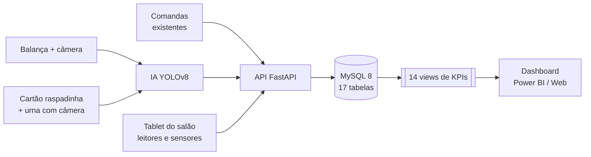

# TasteFlow

> Plataforma de inteligência operacional para restaurantes de autosserviço por quilo: **custo real por cliente, fluxo, ciclo das mesas, satisfação e desperdício** numa só base de dados.

📄 **[Documentação completa](docs/DOCUMENTACAO.md)** ·  🎬 **[Vídeo (2 min)](https://1drv.ms/v/c/2928c3db6e6cec4f/IQCsygT6iyZRRL05Q5gBQjZXAdFwKcyXn8u55G4MDrnD2IQ?e=clVKlY)** · 📊 **[Slides](slides/)** · 🗄️ **[Banco de dados](database/)**

---

## O problema

O restaurante já usa comandas eletrônicas, mas elas registram apenas **o que foi cobrado**. Cinco perguntas continuam sem resposta:

| # | Dor | Pergunta sem resposta |
|---|---|---|
| D1 | Mix do prato | Dois clientes pagaram por 1 kg. Um levou filé mignon e o outro, arroz. Quanto cada um **custou**? |
| D2 | Filas | Quanto tempo o cliente espera no *buffet*, na churrasqueira e pelo garçom? |
| D3 | Mesas | Quanto tempo a mesa fica suja antes de ser limpa e liberada? |
| D4 | Satisfação | Como os clientes avaliam a comida, o ambiente e o atendimento? |
| D5 | Sobras | O que sobra nos pratos e nas cubas, e quanto isso custa? |

## A solução

Cinco módulos ligados pela **comanda individual** de cada cliente:

| Módulo | Como captura | Indicador principal |
|---|---|---|
| **Mix e Custo** | Câmera na balança + IA (YOLOv8) identifica a composição do prato | **Custo Real por Cliente (CRC)** |
| **Fluxo** | Marcos da comanda + leitor na churrasqueira, botão de chamada na mesa e sensor na saída | Tempo por etapa e mapa de calor por horário |
| **Mesas** | A equipe toca na mesa num *tablet*: ocupada → desocupada → limpeza → pronta | Tempo de liberação e giro |
| **Satisfação** | Cartão raspadinha (0 a 5) entregue no caixa; leitura óptica ou digitação; **café grátis garantido** na próxima visita | CSAT por dimensão, índice de recomendação e **taxa de retorno** |
| **Sobras** | Balança + câmera no descarte e registro de produção das cubas | Food Waste Index (FWI) |



**Por que cartão raspadinha e não QR Code?** O cliente não quer pegar o celular para responder pesquisa. O cartão se responde em segundos, com o próprio talher, e o brinde garantido dá um motivo para devolver. O brinde é igual para todos e não depende das respostas, o que evita notas infladas e não configura sorteio, que exigiria autorização (Lei 5.768/1971). Detalhes na [Seção 5.4 da documentação](docs/DOCUMENTACAO.md#54-módulo-satisfação-cartão-raspadinha-com-brinde-d4).

## Resultados da validação (dados simulados)

O banco foi testado com **14 dias simulados** (1.950 clientes, 812 ciclos de mesa):

- 🥩 **Picanha, alcatra e filé mignon** somam **18,4% do peso servido e 50,1% do custo**.
- 💰 Os clientes do quartil mais caro custam **R$ 26,24**, e os do mais barato, **R$ 6,72**, pagando o mesmo preço por quilo.
- ⏱️ A fila do *buffet* vai de **5,1 min às 11h** para **14,1 min às 12h**.
- 🧹 **Metade** dos 9 minutos de liberação da mesa é espera até a limpeza começar.
- ⭐ A satisfação com o ambiente cai de **77,4%** (fila de até 5 min) para **16,8%** (fila de 15 min ou mais).
- ☕ O brinde de café custa **0,55% da receita** do *buffet* e mede quantos clientes voltam em uma semana.
- 🤖 O modelo de visão de demonstração identifica os alimentos com **mAP50 de 0,978** em pratos sintéticos e acertou os 5 itens de um prato feito real. O modelo de produção precisa de fotos reais anotadas ([ia/README.md](ia/README.md)).
- 🗑️ Desperdício de **15,9%** da produção. Os legumes passam de 35%, mas a **picanha** tem o maior custo absoluto de desperdício.

*Os números são de uma simulação e validam o funcionamento do modelo. Eles não descrevem o restaurante real.*

## Capturas de tela

| | |
|---|---|
|  |  |
|  |  |
|  | |

## Vídeo e apresentação

- 🎬 Vídeo de demonstração (até 2 min): **[link](video/link-video.md)**
- 📊 Slides (5): **[slides/](slides/)**

## Estrutura do repositório

```
├── README.md                 esta página
├── docs/DOCUMENTACAO.md      documentação técnica completa
├── docs/diagramas/           DER, arquitetura e fluxos (PNG)
├── docs/img/                 capturas de tela
├── database/                 scripts MySQL (schema, regras, views, dados simulados)
├── backend/                  API FastAPI + testes
├── ia/                       visão computacional: configs, treino, modelo de demonstração, estação da balança
├── frontend/                 painel web
├── slides/                   apresentação
├── video/                    link do vídeo
└── docker-compose.yml        MySQL + API
```

## Como executar

**Banco + API com Docker:**

```bash
docker compose up --build
# API e documentação interativa: http://localhost:8000/docs
```

**Ou manualmente** (MySQL 8.0.16+ e Python 3.11+):

```bash
mysql -u root -p -e "CREATE DATABASE restaurante CHARACTER SET utf8mb4;"
cd database
for f in 01_schema_base.sql 02_schema_extensao.sql 03_procedures_triggers.sql 04_views_kpis.sql 05_seed.sql; do
  mysql -u root -p restaurante < $f
done

cd ../backend
pip install -r requirements.txt
cp .env.example .env        # ajuste usuário e senha
uvicorn app.main:app --reload
```

Detalhes em [backend/README.md](backend/README.md) e no [Apêndice B da documentação](docs/DOCUMENTACAO.md#apêndice-b--guia-de-execução).

## Status de implementação

| Frente | Status |
|---|---|
| Banco de dados (17 tabelas, 14 views, trigger, 4 procedures) | ✅ Implementado e testado |
| Back-end (API FastAPI, 60 testes) | ✅ Implementado e testado |
| IA de visão (YOLOv8-seg) | ✅ Pipeline completo e modelo de demonstração (pratos sintéticos); ⚙️ modelo de produção depende de fotos reais anotadas |
| Estação da balança (borda) | ✅ Implementada: comanda → balança → câmera → modelo → API |
| Leitura óptica do cartão (OpenCV) | ✅ Implementada e testada com cartões sintéticos |
| Front-end / dashboard | 🔜 Consome `/kpis` e `/mesas` |

## Tecnologias

MySQL 8 · Python · FastAPI · YOLOv8 · OpenCV · Power BI · React / Next.js · Azure

## Equipe

| Nome | Frente |
|---|---|
| _Integrante 1_ | Banco de dados |
| _Integrante 2_ | Back-end |
| _Integrante 3_ | IA / visão computacional |
| _Integrante 4_ | Front-end / dashboard |
