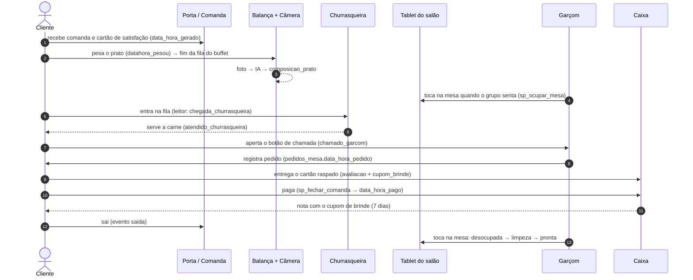
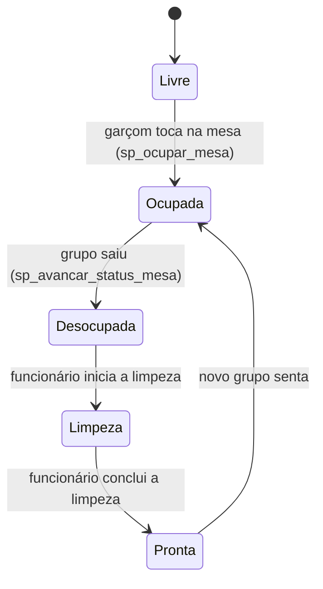
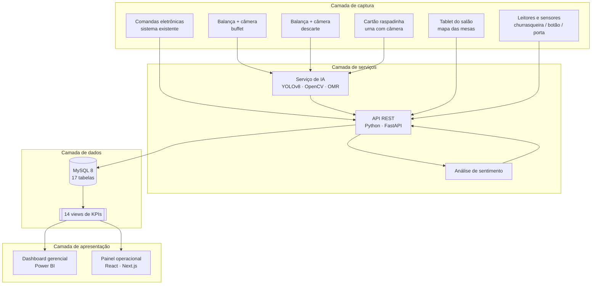
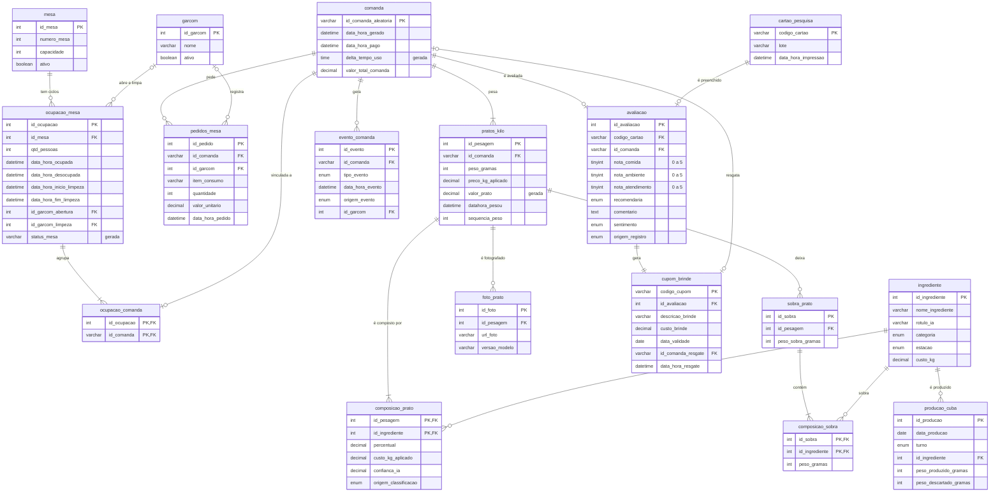
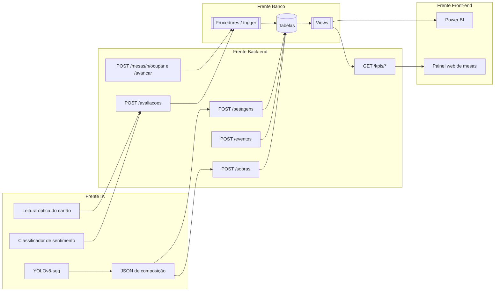

# TasteFlow

## Plataforma de inteligência operacional para restaurantes de autosserviço por quilo

**Documentação técnica do projeto**

---

### Resumo

Restaurantes de autosserviço por quilo cobram o mesmo preço por grama, qualquer que seja o alimento escolhido. Por isso, dois clientes que pagam o mesmo valor podem gerar custos muito diferentes para o estabelecimento. O restaurante estudado já usa comandas eletrônicas, mas não mede o tempo que os clientes passam em cada etapa do atendimento, o ciclo de ocupação e limpeza das mesas, a satisfação com a comida e com o ambiente, nem o custo real do prato de cada cliente. Este trabalho propõe a **TasteFlow**, uma plataforma que integra as comandas existentes a quatro novas fontes de dados: visão computacional na balança, um mapa do salão operado pela equipe em *tablet*, leitores e sensores de fluxo, e um cartão de satisfação no estilo raspadinha, com brinde garantido para quem responde. A partir dessas fontes, a plataforma calcula indicadores como o Índice de Custo do Cliente (ICC), o Custo Real por Cliente (CRC), os tempos de fila por etapa, os tempos de permanência, espera de limpeza e liberação das mesas, o índice de satisfação (CSAT) por dimensão, a taxa de retorno de clientes e o *Food Waste Index* (FWI). O modelo de dados foi implementado em MySQL 8, com 17 tabelas, 14 *views* analíticas, uma *trigger* e quatro *procedures*, exposto por uma API REST com 60 testes automatizados, e o pipeline de visão computacional foi implementado e validado com um modelo de demonstração, e foi validado com uma base simulada de 14 dias de operação (1.950 clientes). Na simulação, três cortes nobres (picanha, alcatra e filé mignon) somaram 18,4% do peso servido e 50,1% do custo de insumos. A satisfação com o ambiente caiu de 77,4%, para filas de até 5 minutos, para 16,8%, para filas de 15 minutos ou mais. O desperdício agregado foi de 15,9% da produção.

**Palavras-chave:** restaurante por quilo; custo por cliente; visão computacional; satisfação do cliente; desperdício de alimentos; gestão operacional.

---

### Sumário

1. [Introdução](#1-introdução)
2. [Referencial teórico](#2-referencial-teórico)
3. [Metodologia](#3-metodologia)
4. [Diagnóstico: as dores do restaurante](#4-diagnóstico-as-dores-do-restaurante)
5. [Solução proposta](#5-solução-proposta)
6. [Arquitetura da solução](#6-arquitetura-da-solução)
7. [Modelagem de dados](#7-modelagem-de-dados)
8. [Regras de negócio implementadas no banco](#8-regras-de-negócio-implementadas-no-banco)
9. [Indicadores de desempenho](#9-indicadores-de-desempenho)
10. [Integração entre as frentes do projeto](#10-integração-entre-as-frentes-do-projeto)
11. [Validação com dados simulados](#11-validação-com-dados-simulados)
12. [Tecnologias e estrutura do repositório](#12-tecnologias-e-estrutura-do-repositório)
13. [Limitações e trabalhos futuros](#13-limitações-e-trabalhos-futuros)
14. [Considerações finais](#14-considerações-finais)
15. [Referências](#referências)
- [Apêndice A — Dicionário de dados](#apêndice-a--dicionário-de-dados)
- [Apêndice B — Guia de execução](#apêndice-b--guia-de-execução)

---

## 1. Introdução

### 1.1 Contexto

No restaurante de autosserviço por quilo, o cliente monta o próprio prato num *buffet* e paga pelo peso, a um preço único por quilo. O modelo é popular no Brasil porque é rápido e deixa o cliente escolher. Para o gestor, porém, ele traz um problema estrutural: a receita depende só do peso, enquanto o custo depende da composição do prato. Um quilo de arroz e um quilo de filé mignon rendem o mesmo valor no caixa, mas o custo de insumo do segundo pode ser mais de dez vezes maior.

O restaurante objeto deste estudo já tem um sistema de comandas eletrônicas, com uma comanda individual por cliente, pesagens associadas a ela e pedidos feitos à mesa pelos garçons. Esse sistema registra **o que foi cobrado**, mas não **o que foi consumido**, **quanto tempo cada etapa levou** nem **como o cliente avaliou a experiência**.

### 1.2 Problema de pesquisa

> Como transformar os dados de um sistema de comandas eletrônicas, somados a sensores de baixo custo e a visão computacional, em indicadores capazes de medir o custo real por cliente, os gargalos de fluxo, o ciclo de ocupação das mesas, a satisfação dos clientes e o desperdício de alimentos?

### 1.3 Objetivo geral

Projetar e implementar a base de dados e a camada analítica de uma plataforma que meça, de forma contínua e automatizada, os principais indicadores operacionais e financeiros de um restaurante por quilo.

### 1.4 Objetivos específicos

1. Estimar a **composição de cada prato** pesado e calcular seu custo real (ICC/CRC).
2. Medir os **tempos de cada etapa** da jornada do cliente: fila do *buffet*, fila da churrasqueira, espera pelo garçom e permanência total.
3. Controlar o **ciclo completo da mesa**: ocupação, espera pela limpeza, limpeza e liberação.
4. Medir a **satisfação** com comida, ambiente e atendimento por meio de uma pesquisa de baixo atrito e com incentivo, que alcance a maioria dos clientes.
5. Quantificar o **desperdício** por ingrediente, separando a sobra no prato do descarte das cubas.
6. Consolidar tudo num **dashboard** de apoio à decisão.

### 1.5 Justificativa

Segundo o Programa das Nações Unidas para o Meio Ambiente (UNEP, 2024), em 2022 foram geradas 1,05 bilhão de toneladas de resíduos alimentares no varejo, nos serviços de alimentação e nos domicílios. Isso equivale a 132 kg por pessoa e a quase um quinto de todo o alimento disponível aos consumidores. Os serviços de alimentação responderam por 28% desse total, cerca de 290 milhões de toneladas. Além do impacto ambiental, cada quilo descartado é custo pago e não convertido em receita.

Há também uma dimensão de experiência. Filas longas e mesas sujas afetam a percepção do cliente e reduzem o giro do salão, o que limita o faturamento nos horários de pico. Sem medição, essas perdas ficam invisíveis para o gestor.

---

## 2. Referencial teórico

### 2.1 Gestão de receita em restaurantes

Kimes *et al.* (1998) adaptaram para restaurantes os conceitos de gestão de receita (*revenue management*) da hotelaria e da aviação. Eles definem a capacidade do salão em termos de **assentos × tempo** e propõem medir a receita por assento disponível por hora (*RevPASH*). Dois fatores são decisivos nesse modelo: a **duração da refeição** e a **previsibilidade do tempo de ocupação**. Kimes (1999) propõe um método em cinco etapas cujo ponto de partida é a medição sistemática dos tempos de uso das mesas. Este trabalho segue essa recomendação ao registrar cada etapa do ciclo da mesa: permanência, espera pela limpeza, limpeza e liberação.

### 2.2 Custo da mercadoria vendida e mix de produtos

Em serviços de alimentação, o **custo da mercadoria vendida (CMV)** é a razão entre o custo dos insumos consumidos e a receita. No autosserviço por quilo, o CMV de um prato varia com a sua composição, que hoje não é observada. Medir o mix por prato permite calcular o CMV individual, aqui chamado de **Índice de Custo do Cliente**, e identificar quais itens, horários e perfis de consumo corroem a margem.

### 2.3 Visão computacional para reconhecimento de alimentos

O reconhecimento automático de alimentos em imagens é uma área consolidada da chamada *food computing* (MIN *et al.*, 2019). Detectores de estágio único da família YOLO (REDMON *et al.*, 2016) localizam e classificam objetos numa única passagem pela rede, o que viabiliza a inferência em tempo real em *hardware* modesto. A versão YOLOv8 (JOCHER; CHAURASIA; QIU, 2023) também oferece segmentação de instâncias, o que permite estimar a **área relativa** ocupada por cada alimento no prato. Neste projeto, essa área relativa é combinada com o **peso real** medido pela balança para estimar os gramas de cada item.

### 2.4 Medição da satisfação: NPS e CSAT

Reichheld (2003) propôs o *Net Promoter Score* (NPS) a partir de uma única pergunta: *"Qual a probabilidade de você recomendar esta empresa a um amigo?"*, respondida numa escala de 0 a 10. Quem responde 9 ou 10 é promotor, e quem responde de 0 a 6 é detrator. O índice é a diferença percentual entre os dois grupos. O NPS depende dessa escala de 11 pontos e dos seus cortes.

O **CSAT** (*Customer Satisfaction Score*) mede a satisfação com um aspecto específico numa escala curta, e o índice é a porcentagem de respostas nas notas mais altas. Ele é mais adequado quando a pesquisa precisa ser respondida em segundos e o objetivo é localizar **onde** está a insatisfação (comida, ambiente ou atendimento), e não apenas medir a lealdade geral.

Este trabalho adota o CSAT numa escala de 0 (insatisfeito) a 5 (satisfeito), com as notas 4 e 5 como satisfação. A pergunta de recomendação foi mantida em forma simplificada (sim, talvez, não), e dela se calcula um **índice de recomendação** (% de "sim" − % de "não") inspirado no NPS. Como a escala é diferente, esse índice não é comparável ao NPS publicado por outras empresas.

### 2.5 Taxa de resposta e incentivos

Pesquisas de satisfação costumam ter baixa adesão, e quem responde espontaneamente tende a ser quem teve uma experiência muito boa ou muito ruim. Isso distorce os resultados. A literatura sobre pesquisas mostra que incentivos aumentam a taxa de resposta (SINGER; YE, 2013). Também mostra que reduzir o esforço do respondente aumenta a adesão.

Dois cuidados acompanham o uso de incentivos. O primeiro é o viés: se o respondente acreditar que a recompensa depende da resposta, tende a inflar as notas. Por isso a recompensa deve ser **igual para todos** e explicitamente independente das respostas. O segundo é legal: no Brasil, a distribuição gratuita de prêmios a título de propaganda mediante sorteio, vale-brinde, concurso ou operação assemelhada depende de autorização prévia do Ministério da Fazenda (BRASIL, 1971). Um brinde garantido, sem fator sorte, não se enquadra nessas modalidades.

### 2.6 Análise de sentimento

A análise de sentimento classifica automaticamente a polaridade (positiva, neutra ou negativa) de textos opinativos (LIU, 2012). Ela complementa as notas numéricas, porque comentários como "carne fria" ou "mesa suja" apontam a **causa** de uma nota baixa. No cartão de satisfação o comentário é opcional e digitado pelo caixa quando houver.

### 2.7 Desperdício de alimentos

O UNEP (2024) acompanha a meta 12.3 dos Objetivos de Desenvolvimento Sustentável, que prevê reduzir pela metade o desperdício de alimentos até 2030, e recomenda medir o desperdício diretamente, por pesagem. Este projeto adota essa recomendação no nível do estabelecimento e separa duas fontes: a **sobra no prato**, que o cliente serviu e não comeu, e o **descarte da cuba**, que foi produzido e nunca chegou a ser servido.

### 2.8 Modelagem de dados

O modelo segue a abordagem entidade-relacionamento (CHEN, 1976) e as formas normais usuais (ELMASRI; NAVATHE, 2011). Valores deriváveis, como tempos e status, são calculados por **colunas geradas** ou por *views*, e não gravados de forma redundante. Assim os dados continuam consistentes quando um horário é corrigido.

---

## 3. Metodologia

O projeto segue a *Design Science Research* (HEVNER *et al.*, 2004), indicada para pesquisas cujo resultado é um artefato tecnológico que resolve um problema real. O processo teve seis etapas:

| Etapa | Atividade | Produto |
|---|---|---|
| 1. Identificação do problema | Levantamento das dores com a gestão do restaurante | Seção 4 (diagnóstico) |
| 2. Definição dos objetivos | Tradução de cada dor em um indicador mensurável | Seção 9 (KPIs) |
| 3. Projeto do artefato | Arquitetura, escolha de sensores e modelagem de dados | Seções 5 a 7 |
| 4. Desenvolvimento | Implementação do banco (tabelas, regras, *views*) | Pasta `database/` |
| 5. Demonstração | Geração de 14 dias de dados simulados e consulta dos KPIs | Seção 11 |
| 6. Avaliação | Verificação da coerência dos indicadores e das regras | Seções 11 e 13 |

A *Design Science Research* é iterativa: o artefato é avaliado e redesenhado. Neste projeto houve uma iteração relevante. A primeira versão previa QR Codes nas mesas, lidos pelo cliente ao sentar, e na nota fiscal, para uma pesquisa NPS no celular. A avaliação crítica da jornada mostrou que ambos dependiam de uma ação voluntária do cliente, com celular e internet, num momento em que ele quer comer ou ir embora. Isso levaria a dados incompletos e a uma taxa de resposta baixa e enviesada. A versão final transfere o registro das mesas para a equipe, num *tablet* com o mapa do salão, e troca a pesquisa digital por um cartão de papel no estilo raspadinha, com brinde garantido (Seção 5.4).

Uma premissa orientou o projeto: **não alterar o sistema de comandas existente**. As quatro tabelas originais (`garcom`, `comanda`, `pratos_kilo`, `pedidos_mesa`) foram mantidas como estão, e toda a extensão foi feita com tabelas novas ligadas a elas por chaves estrangeiras. Isso reduz o risco de implantação e permite adotar os módulos aos poucos.

---

## 4. Diagnóstico: as dores do restaurante

| # | Dor | Situação atual | Consequência |
|---|---|---|---|
| D1 | **Mix do prato servido** | Sabe-se o peso, não a composição | Clientes com o mesmo valor pago geram custos muito diferentes; a margem real é desconhecida |
| D2 | **Filas e tempo do cliente** | Não há registro de espera no *buffet*, na churrasqueira ou pelo garçom | Os gargalos dos horários de pico não são dimensionados |
| D3 | **Limpeza do salão** | Não se sabe quanto tempo a mesa fica suja nem quanto dura a limpeza | Mesas ociosas no pico e menor giro do salão |
| D4 | **Qualidade e satisfação** | O *feedback* é informal | Não há métrica de comida, ambiente ou atendimento |
| D5 | **Sobras** | Não se sabe o que sobra no prato nem nas cubas | Produção mal dimensionada e desperdício sem custo atribuído |

O sistema atual já fornece quatro marcos de tempo úteis, que foram reaproveitados:

- `comanda.data_hora_gerado`: entrada do cliente;
- `pratos_kilo.datahora_pesou`: momento da pesagem, que marca o fim da fila do *buffet*;
- `pedidos_mesa.data_hora_pedido`: atendimento do garçom;
- `comanda.data_hora_pago`: pagamento.

---

## 5. Solução proposta

A **TasteFlow** é composta por cinco módulos que compartilham a mesma chave: a **comanda individual** do cliente.

### 5.1 Módulo Mix e Custo (D1)

**Captura.** Uma câmera fixa acima da balança fotografa o prato no momento da pesagem. A foto é gravada em `foto_prato` e enviada ao serviço de inferência.

**Inferência.** Um modelo YOLOv8 de segmentação, treinado com as classes do cardápio (`ingrediente.rotulo_ia`), retorna as regiões de cada alimento. O percentual de cada item é estimado pela sua fração da área segmentada.

**Cálculo.** O banco converte o percentual em gramas usando o peso real da balança e multiplica pelo custo/kg do ingrediente. O custo/kg é **congelado** em `composicao_prato.custo_kg_aplicado`, o que preserva o histórico se o preço do insumo mudar.

```json
{
  "id_pesagem": 1532,
  "peso_gramas": 850,
  "itens": [
    {"rotulo": "arroz_branco", "percentual": 20.0, "confianca": 0.94},
    {"rotulo": "feijao",       "percentual": 10.0, "confianca": 0.91},
    {"rotulo": "file_mignon",  "percentual": 50.0, "confianca": 0.88},
    {"rotulo": "salada_folhas","percentual": 20.0, "confianca": 0.86}
  ]
}
```

Quando a confiança é baixa, um funcionário pode corrigir a classificação, que fica marcada como `origem_classificacao = 'manual'`. Essas correções também servem como dado para retreinar o modelo.

**Treinamento.** A pasta `ia/` contém o pipeline completo: configuração do *dataset* com as classes iguais a `ingrediente.rotulo_ia`, conversão de fotos anotadas, treino, avaliação, exportação para ONNX e o programa da estação da balança. Como ainda não há fotos anotadas do restaurante, o pipeline foi validado com um modelo de demonstração treinado em pratos sintéticos (Seção 11.7).

**Dois modos de inferência.** Na **borda**, a estação da balança roda o modelo e envia a composição pronta (`POST /pesagens`). No **servidor**, a estação envia só a foto (`POST /pesagens/foto`). O primeiro reduz o tráfego de imagens e funciona mesmo com a rede lenta.

### 5.2 Módulo Fluxo do Cliente (D2)

A jornada é reconstruída combinando os marcos já existentes com eventos novos, gravados em `evento_comanda`:



Na churrasqueira, o churrasqueiro passa a comanda num leitor quando o cliente entra na fila e de novo quando o serve. O chamado do garçom vem de um botão de chamada na mesa, do tipo campainha sem fio, comum em restaurantes. A saída é captada por sensor na porta ou na catraca. Em nenhum desses pontos o cliente precisa fazer algo além do que já faz hoje.

### 5.3 Módulo Mesas e Limpeza (D3)

O ciclo da mesa é registrado **somente pela equipe**, num *tablet* com o mapa do salão. O garçom toca na mesa quando o grupo senta, e os funcionários tocam de novo quando o grupo sai e quando começam e terminam a limpeza. A mesa é modelada como uma **máquina de estados**, e cada ciclo vira uma linha em `ocupacao_mesa`:



O status atual e os tempos de cada etapa são **colunas geradas**, no mesmo padrão de `comanda.delta_tempo_uso`. Um painel mostra o estado das mesas em tempo real (verde: livre; amarelo: desocupada ou em limpeza; vermelho: ocupada) e alerta quando uma mesa suja fica mais de 5 minutos sem limpeza. Vincular as comandas do grupo à mesa é opcional: o garçom pode fazê-lo ao anotar um pedido, mas nenhum indicador depende disso.

### 5.4 Módulo Satisfação: cartão raspadinha com brinde (D4)

Na entrada, junto com a comanda, o cliente recebe um cartão de papel. Cada linha tem bolinhas cobertas por tinta raspável, e o cliente raspa uma bolinha por linha com o próprio talher:

```
┌──────────────────────────────────────────────────┐
│  TasteFlow · Como foi sua refeição?   ║║║ C4F7A21│
│  Raspe com o talher uma bolinha por linha:       │
│                                                  │
│  Comida         ⓪  ①  ②  ③  ④  ⑤               │
│  Ambiente       ⓪  ①  ②  ③  ④  ⑤               │
│  Atendimento    ⓪  ①  ②  ③  ④  ⑤               │
│  Recomendaria?  (Sim)  (Talvez)  (Não)           │
│                                                  │
│  Entregue no caixa e ganhe um café grátis        │
│  na próxima visita. O brinde não depende         │
│  das suas respostas.                             │
└──────────────────────────────────────────────────┘
        0 = insatisfeito · 5 = satisfeito
```

**Registro.** O cliente entrega o cartão no caixa ao pagar. Há duas formas de lançamento:
- **Leitura óptica:** o cartão é colocado numa urna com encaixe fixo e câmera. O serviço de leitura (OMR, *Optical Mark Recognition*) mede a escuridão de cada bolinha nas posições do gabarito e identifica a raspada em cada linha. Se uma linha estiver em branco ou tiver duas bolinhas raspadas, a leitura é recusada.
- **Digitação pelo caixa:** usada quando a leitura óptica recusa o cartão ou não está disponível. São quatro toques, que levam poucos segundos.

**Brinde garantido.** Todo cartão preenchido gera na hora um cupom (`cupom_brinde`) de café expresso grátis, válido por 7 dias e impresso na nota. O benefício é o mesmo para todos e não depende das respostas, por três motivos:
1. **Adesão:** o incentivo certo aumenta a taxa de resposta e reduz o viés de quem só responde quando está muito satisfeito ou muito insatisfeito.
2. **Honestidade das notas:** como o cartão diz que o brinde independe das respostas, o cliente não tem motivo para inflar a nota.
3. **Conformidade legal:** sem sorte envolvida, a ação não é sorteio nem vale-brinde, que exigiriam autorização prévia (BRASIL, 1971).

**Controle.** Os cartões são impressos em lotes com código de barras único (`cartao_pesquisa`). Só cartões cadastrados geram brinde, e cada um vale uma vez. Isso impede cópias.

**Retorno do cliente.** Quando o cliente volta e apresenta o cupom, o caixa o resgata (`sp_resgatar_cupom`). O café entra na comanda como item de valor zero, o que mantém o fechamento original inalterado. O resgate gera um indicador que antes não existia: a **taxa de retorno**, a porcentagem de clientes que voltaram dentro de 7 dias.

Como a avaliação fica ligada à comanda, continua sendo possível cruzar satisfação com a operação, por exemplo CSAT × tempo de fila ou CSAT do atendimento × garçom.

### 5.5 Módulo Sobras (D5)

Na estação de descarte, o prato é pesado de novo e fotografado antes de ir para o lixo (`sobra_prato`), e a IA estima a composição da sobra (`composicao_sobra`). No fim de cada turno, a cozinha registra quanto produziu e quanto descartou de cada cuba (`producao_cuba`). Com isso o **Food Waste Index** separa as duas origens do desperdício.

---

## 6. Arquitetura da solução



| Camada | Responsabilidade | Status |
|---|---|---|
| Captura | Gerar eventos com carimbo de tempo | Estação da balança **implementada** (`ia/scripts/estacao_balanca.py`); demais sensores especificados |
| IA | Identificar os alimentos do prato | Pipeline **implementado**; modelo de demonstração treinado (Seção 11.7); modelo de produção depende de fotos reais |
| Serviços | Validar, enriquecer (IA) e gravar os dados | **Implementada e testada** (API FastAPI, 60 testes; Seção 10) |
| Dados | Persistência, integridade, regras de negócio e KPIs | **Implementada e validada** |
| Apresentação | Visualização gerencial e operacional | Especificada (consome as *views*) |

A separação em camadas permite que o dashboard consulte apenas as *views*. Se uma regra de cálculo mudar, basta alterar a *view*, sem mexer em código do *front-end*.

---

## 7. Modelagem de dados

### 7.1 Visão geral

O modelo tem **17 tabelas**: 4 do sistema original e 13 novas.

| Grupo | Tabelas |
|---|---|
| Sistema original | `garcom`, `comanda`, `pratos_kilo`, `pedidos_mesa` |
| Mesas | `mesa`, `ocupacao_mesa`, `ocupacao_comanda` |
| Fluxo | `evento_comanda` |
| Mix e custo | `ingrediente`, `foto_prato`, `composicao_prato` |
| Satisfação | `cartao_pesquisa`, `avaliacao`, `cupom_brinde` |
| Sobras | `sobra_prato`, `composicao_sobra`, `producao_cuba` |

### 7.2 Diagrama entidade-relacionamento



### 7.3 Decisões de projeto

**a) Preservação do modelo original.** Nenhuma coluna das quatro tabelas originais foi alterada. O padrão de nomes (`id_*`, `data_hora_*`, `delta_tempo_*`) foi repetido nas tabelas novas para manter a consistência.

**b) A comanda individual como unidade de análise.** Como cada cliente tem a própria comanda, o custo por comanda **é** o custo por cliente. Isso responde diretamente ao exemplo motivador do trabalho: fulano pegou 1 kg de filé mignon, ciclano pegou 1 kg de arroz.

**c) Mesa registrada pela equipe, vínculo com a comanda opcional.** O ciclo da mesa não depende de nenhuma ação do cliente. Quando o garçom quiser, pode vincular as comandas do grupo à ocupação; a tabela `ocupacao_comanda` resolve essa relação N:1 sem alterar `comanda`. Nenhum indicador depende desse vínculo.

**d) Um ciclo por linha, com colunas geradas.** Em vez de registrar cada mudança de estado como uma linha separada, `ocupacao_mesa` guarda os quatro horários do ciclo. O status e os quatro tempos (`delta_tempo_permanencia`, `delta_tempo_espera_limpeza`, `delta_tempo_limpeza` e `delta_tempo_liberacao`) são colunas `GENERATED ALWAYS ... VIRTUAL`. Assim não é possível haver um status incoerente com os horários.

**e) Reaproveitamento dos marcos existentes.** `evento_comanda` registra só o que o sistema ainda não captava: churrasqueira, chamado do garçom e saída. Entrada, pesagem, atendimento e pagamento já existiam.

**f) A IA grava percentual, não peso.** A câmera estima proporção, e a balança mede massa. Guardar o percentual e calcular os gramas na *view* aproveita a medida mais confiável de cada sensor.

**g) Custo congelado.** `custo_kg_aplicado` registra o custo vigente no momento da pesagem, o que garante a reprodutibilidade histórica dos indicadores.

**h) Integridade declarativa.** `CHECK` constraints validam faixas (notas de 0 a 5, percentuais entre 0 e 100, descarte menor ou igual à produção), a ordem cronológica dos horários do ciclo da mesa e a coerência do resgate do cupom (comanda e horário preenchidos juntos).

**i) Brinde como item de valor zero.** O resgate do cupom insere em `pedidos_mesa` um item "Brinde" com valor R$ 0,00. Assim, a consulta de fechamento original da equipe continua correta sem nenhuma alteração, e o brinde fica registrado na comanda da visita de retorno.

**j) Cartão cadastrado e de uso único.** `avaliacao.codigo_cartao` é chave estrangeira para `cartao_pesquisa` e tem restrição de unicidade. Cartões copiados ou inventados não geram brinde, e cada cartão só pode ser usado uma vez.

---

## 8. Regras de negócio implementadas no banco

Arquivo: `database/03_procedures_triggers.sql`.

| Objeto | Tipo | Regra |
|---|---|---|
| `trg_ocupacao_unica` | *Trigger* `BEFORE INSERT` | Impede abrir um novo ciclo numa mesa cujo ciclo anterior ainda não terminou a limpeza |
| `sp_fechar_comanda(id)` | *Procedure* | Consulta de fechamento original da equipe, parametrizada: grava o horário de pagamento e soma pesagens e pedidos |
| `sp_ocupar_mesa(numero, pessoas, id_garcom)` | *Procedure* | O garçom registra a chegada do grupo; recusa se a mesa estiver ocupada ou aguardando limpeza |
| `sp_avancar_status_mesa(numero, id_garcom)` | *Procedure* | Avança o ciclo uma etapa a cada toque do funcionário: ocupada → desocupada → limpeza → pronta |
| `sp_resgatar_cupom(codigo, id_comanda)` | *Procedure* | Valida o cupom (existe, não resgatado, dentro da validade, outra visita, comanda aberta) e lança o brinde como item de valor zero |

Todas as regras foram testadas, inclusive nos casos de erro: ocupar uma mesa em limpeza, abrir um ciclo duplicado, gravar uma nota fora da faixa e resgatar um cupom vencido ou já usado.

---

## 9. Indicadores de desempenho

Arquivo: `database/04_views_kpis.sql`.

### 9.1 Fórmulas

**Índice de Custo do Cliente (por pesagem)**

$$ICC = \sum_{i \in \text{itens}} \left( P_{\text{prato}} \times \frac{p_i}{100} \times \frac{C_i}{1000} \right)$$

onde $P_{\text{prato}}$ é o peso do prato em gramas, $p_i$ é o percentual estimado do item $i$ e $C_i$ é o custo do item em R$/kg.

**Custo Real por Cliente**

$$CRC = \sum_{\text{pesagens da comanda}} ICC$$

**Margem do *buffet***

$$M\% = \frac{\text{Receita}_{\text{buffet}} - CRC}{\text{Receita}_{\text{buffet}}} \times 100$$

**Participação no custo × participação no peso (por ingrediente)**

$$\text{Índice de impacto}_i = \frac{\%\,\text{custo}_i}{\%\,\text{peso}_i}$$

Um índice maior que 1 indica um item que pesa mais no custo do que no prato.

**Tempos de fluxo (minutos)**

| Indicador | Início | Fim |
|---|---|---|
| Fila do *buffet* | `comanda.data_hora_gerado` | 1ª `pratos_kilo.datahora_pesou` |
| Fila da churrasqueira | evento `chegada_churrasqueira` | evento `atendido_churrasqueira` |
| Espera pelo garçom | evento `chamado_garcom` | 1º `pedidos_mesa.data_hora_pedido` posterior, registrado por garçom (brindes não contam) |
| Permanência | `data_hora_gerado` | evento `saida` |

**Ciclo da mesa (minutos)**

| Indicador | Início | Fim |
|---|---|---|
| Permanência | `data_hora_ocupada` | `data_hora_desocupada` |
| Espera pela limpeza | `data_hora_desocupada` | `data_hora_inicio_limpeza` |
| Limpeza | `data_hora_inicio_limpeza` | `data_hora_fim_limpeza` |
| Liberação | `data_hora_desocupada` | `data_hora_fim_limpeza` |

**Giro da mesa**

$$\text{Giro} = \frac{\text{ciclos concluídos no dia}}{\text{mesas ativas}}$$

**Satisfação (CSAT) por dimensão $d$** (comida, ambiente, atendimento; escala de 0 a 5)

$$CSAT_d = \frac{n(\text{nota}_d \geq 4)}{n_{\text{respostas}}} \times 100$$

O **CSAT geral** aplica a mesma regra às três dimensões juntas (3 notas por cartão).

**Índice de recomendação**

$$IR = \frac{n(\text{sim}) - n(\text{não})}{n_{\text{respostas}}} \times 100 \qquad (-100 \leq IR \leq +100)$$

**Taxa de resposta**

$$TR = \frac{\text{cartões devolvidos}}{\text{clientes do dia}} \times 100$$

**Taxa de retorno e custo do incentivo**

$$\text{Retorno} = \frac{\text{cupons resgatados}}{\text{cupons emitidos}} \times 100 \qquad \text{Custo do incentivo} = \sum_{\text{resgatados}} \text{custo do brinde}$$

**Food Waste Index (por ingrediente)**

$$FWI_i = \frac{\text{Sobra no prato}_i + \text{Descarte da cuba}_i}{\text{Produzido}_i} \times 100$$

### 9.2 Catálogo de *views*

| *View* | Módulo | Responde a |
|---|---|---|
| `vw_custo_pesagem` | Mix | Quanto custou cada prato pesado? |
| `vw_custo_comanda` | Mix | Qual o custo real e a margem de cada cliente? |
| `vw_rentabilidade_ingrediente` | Mix | Quais itens pesam mais no custo do que no prato? |
| `vw_tempos_comanda` | Fluxo | Quanto tempo cada cliente esperou em cada etapa? |
| `vw_fluxo_por_hora` | Fluxo | Em que dia e horário estão os gargalos? (mapa de calor) |
| `vw_desempenho_garcom` | Fluxo | Qual o tempo de resposta e o CSAT de atendimento de cada garçom? |
| `vw_ciclo_mesa` | Mesas | Quanto durou cada etapa de cada ciclo? |
| `vw_mesa_kpis_diario` | Mesas | Giro e tempos médios por dia |
| `vw_mesas_agora` | Mesas | Painel em tempo real com alerta de mesa suja |
| `vw_satisfacao_diaria` | Satisfação | CSAT por dimensão, índice de recomendação e taxa de resposta por dia |
| `vw_satisfacao_por_fila` | Satisfação | Como a fila afeta a satisfação? |
| `vw_cupons_diario` | Satisfação | Cupons emitidos e resgatados, taxa de retorno e custo dos brindes |
| `vw_desperdicio_ingrediente` | Sobras | FWI e custo do desperdício por item |
| `vw_resumo_diario` | Geral | Cartões-resumo do dashboard |

---

## 10. Integração entre as frentes do projeto

O projeto tem quatro frentes técnicas: banco de dados, *back-end*, IA e *front-end*. Elas se integram por dois contratos: a **API REST**, entre a captura e o banco, e as ***views***, entre o banco e a visualização.



### 10.1 Contrato da API (implementado)

A API está em `backend/` e tem documentação interativa (Swagger) em `/docs`. Cada requisição é executada numa transação única: se algum passo falhar, nada é gravado.

| Método e rota | Origem | Ação no banco |
|---|---|---|
| `POST /comandas` | Porta | `INSERT comanda` com código aleatório (`CMD-` + 12 hexadecimais) |
| `POST /pesagens` | Balança + IA na borda | `INSERT pratos_kilo`, `foto_prato`, `composicao_prato` (custo/kg congelado) |
| `POST /pesagens/foto` | Balança (só a foto) | Inferência YOLOv8-seg no servidor e mesma gravação acima |
| `PUT /pesagens/{id}/composicao` | Funcionário | Correção manual (`origem_classificacao = 'manual'`) |
| `POST /pedidos` | Garçom | `INSERT pedidos_mesa` |
| `POST /mesas/{numero}/ocupar` | Tablet (garçom) | `CALL sp_ocupar_mesa(numero, pessoas, id_garcom)` |
| `POST /mesas/{numero}/avancar` | Tablet (funcionário) | `CALL sp_avancar_status_mesa(numero, id_garcom)` |
| `POST /mesas/{numero}/comandas` | Tablet (garçom) | Vínculo opcional em `ocupacao_comanda` |
| `GET /mesas` | Tablet / painel | `SELECT * FROM vw_mesas_agora` |
| `POST /eventos` | Leitores e sensores | `INSERT evento_comanda`, após validar a sequência |
| `POST /comandas/{id}/fechar` | Caixa | `CALL sp_fechar_comanda(id)` |
| `POST /cartoes/lote` | Gestor | Gera os códigos de um lote de cartões (`cartao_pesquisa`) |
| `POST /avaliacoes` | Caixa | `INSERT avaliacao` e `cupom_brinde` (sentimento do comentário, se houver) |
| `POST /avaliacoes/leitura-otica` | Urna com câmera | Leitura óptica do cartão e mesma gravação acima |
| `POST /cupons/{codigo}/resgatar` | Caixa | `CALL sp_resgatar_cupom(codigo, id_comanda)` |
| `POST /sobras` e `/sobras/foto` | Estação de descarte + IA | `INSERT sobra_prato`, `composicao_sobra` |
| `POST /producao` | Cozinha (fim do turno) | `INSERT ... ON DUPLICATE KEY UPDATE producao_cuba` |
| `GET /kpis` e `/kpis/{nome}` | Dashboard | `SELECT` numa lista fechada das 14 *views*, com filtro por data |

Além das regras do banco, a API valida a **sequência lógica da jornada**:

| Regra | Resposta HTTP |
|---|---|
| Consumo, chamado ou fila da churrasqueira em comanda já paga | 409 |
| Saída em comanda não paga; segunda saída, avaliação da comanda ou sobra | 409 |
| Cartão não cadastrado (cópia) | 404 |
| Cartão já usado; cupom vencido, já resgatado ou usado na própria visita | 409 |
| Atendimento na churrasqueira sem chegada pendente | 409 |
| Comanda vinculada a duas mesas; mesa suja recebendo um novo grupo; grupo maior que a mesa | 409 |
| Rótulo da IA sem ingrediente cadastrado; nota fora de 0 a 5; descarte maior que a produção | 422 |
| Leitura óptica com linha em branco ou duas bolinhas raspadas | 422 (o caixa lança o cartão) |
| Percentuais da IA que não somam 100 | Normalizados |
| Confiança média abaixo de `CONFIANCA_MINIMA` (padrão 0,60) | Pesagem marcada com `revisao_necessaria` |

Os erros do MySQL são traduzidos de forma padronizada: `SIGNAL` das procedures e da *trigger* vira 409 com a mensagem da regra, e violações de `CHECK` ou de chave estrangeira viram 422.

**Serviços de apoio.** O `services/visao.py` converte as máscaras do YOLOv8-seg em percentual por alimento: soma a área por classe e calcula a confiança média ponderada pela área. O `services/leitura_cartao.py` faz a leitura óptica do cartão: mede a escuridão de cada bolinha nas posições do gabarito e escolhe a raspada em cada linha, recusando linhas em branco ou ambíguas. O `services/sentimento.py` traz uma implementação de referência baseada em léxico do português, com tratamento de negação e intensificadores. As interfaces permitem trocar por modelos treinados sem alterar a API.

**Testes.** São 60 testes automatizados (pytest). Eles recriam o banco a partir dos scripts de `database/`, percorrem a jornada completa de um grupo (entrada, pesagem, mesa, churrasqueira, garçom, cartão de satisfação, pagamento, saída, limpeza, sobra e resgate do brinde) e cobrem todos os casos de erro acima. A leitura óptica é testada com cartões sintéticos gerados com OpenCV, inclusive com linhas em branco e ambíguas. O exemplo da Seção 10.2 também é verificado por teste: um prato de 850 g com ICC de R$ 37,08. Um teste de integração envia a foto de um prato ao `POST /pesagens/foto` e confere a composição devolvida pelo modelo treinado.

### 10.2 Ciclo de vida de um dado

Por exemplo, um prato de 850 g com metade de filé mignon segue este caminho:

1. A balança grava `pratos_kilo` (850 g × R$ 89,90/kg = R$ 76,42).
2. A câmera envia a foto, e a IA devolve a composição: filé 50%, arroz 20%, salada 20%, feijão 10%.
3. A API grava `composicao_prato` com o custo/kg do dia.
4. `vw_custo_pesagem` calcula o ICC: 425 g de filé × R$ 78/kg + 170 g de arroz × R$ 6,50/kg + 170 g de salada × R$ 12/kg + 85 g de feijão × R$ 9,20/kg = **R$ 37,08**. A margem desse prato é de 51,5%, contra 74,7% de margem média na simulação.
5. O dashboard soma esse prato ao CRC do cliente, ao custo do horário e ao consumo de filé do dia.

---

## 11. Validação com dados simulados

### 11.1 Desenho da simulação

O arquivo `05_seed.sql` gera 14 dias de almoço (11h às 14h30) num salão de 20 mesas, seguindo regras que imitam o comportamento esperado do restaurante:

- pico de demanda entre 12h e 13h, 40% mais intenso no fim de semana;
- grupos de 1 a 6 pessoas, conforme a capacidade da mesa, com uma comanda por pessoa;
- 75% dos clientes vão à churrasqueira, 55% chamam o garçom e 18% repetem o prato;
- probabilidade de cada ingrediente entrar no prato definida por um perfil de consumo;
- 65% dos clientes devolvem o cartão de satisfação; as notas de ambiente e atendimento e a recomendação caem à medida que a fila aumenta;
- 75% dos cartões são lidos pela urna e 25% digitados pelo caixa;
- cerca de 38% dos cupons de brinde são resgatados numa visita posterior, dentro da validade;
- legumes e saladas têm maior chance de sobrar no prato e são produzidos com mais folga.

> **Importante:** os números abaixo **validam o funcionamento do modelo e das *views***, não descrevem o restaurante real. Eles vêm de uma execução da simulação (12/11 a 25/11/2026) e mudam a cada nova execução. Com a plataforma em operação, as mesmas consultas passam a refletir dados reais.

Volume gerado: **1.950 comandas (clientes)**, **2.287 pesagens**, **1.077 pedidos à mesa**, **812 ciclos de mesa concluídos**, **1.248 cartões de satisfação devolvidos**, **1.248 cupons de brinde emitidos** (434 resgatados) e **1.246 registros de sobra**.

### 11.2 Mix e custo (D1)

| Indicador | Valor simulado |
|---|---|
| Peso médio por cliente | 654 g |
| Receita média do *buffet* por cliente | R$ 60,60 |
| CRC médio | R$ 15,27 (mínimo R$ 2,50; máximo R$ 50,44) |
| CMV do *buffet* | 25,2% |

**Participação no peso × no custo (destaques):**

| Ingrediente | % do peso | % do custo | Índice de impacto |
|---|---:|---:|---:|
| Picanha | 6,2 | 19,2 | 3,1 |
| Alcatra | 7,8 | 16,1 | 2,1 |
| Filé mignon | 4,4 | 14,8 | 3,4 |
| Camarão | 1,1 | 4,2 | 3,8 |
| Arroz branco | 21,7 | 6,0 | 0,3 |
| Feijão | 11,4 | 4,5 | 0,4 |

Três cortes nobres (picanha, alcatra e filé) respondem por **18,4% do peso e 50,1% do custo**. Guarnições, saladas, legumes e massas somam **63,5% do peso e apenas 27,1% do custo**.

**Clientes por quartil de CRC:**

| Quartil | CRC médio | % de proteína no prato | Margem do *buffet* |
|---|---:|---:|---:|
| 1º (mais baratos) | R$ 6,72 | 18,4% | 84,6% |
| 2º | R$ 11,42 | 32,9% | 77,3% |
| 3º | R$ 16,70 | 40,4% | 72,7% |
| 4º (mais caros) | R$ 26,24 | 50,6% | 64,3% |

O cliente do 4º quartil custa quase **quatro vezes** mais que o do 1º, pagando praticamente o mesmo preço por quilo. Essa diferença fica invisível no sistema atual de comandas.

### 11.3 Fluxo do cliente (D2)

| Hora | Fila do *buffet* | Fila da churrasqueira | Espera pelo garçom | Permanência |
|---|---:|---:|---:|---:|
| 11h | 5,1 min | 2,5 min | 2,8 min | 56,2 min |
| **12h** | **14,1 min** | **7,1 min** | **5,9 min** | **66,3 min** |
| 13h | 9,2 min | 4,5 min | 4,3 min | 60,1 min |
| 14h | 5,0 min | 2,5 min | 2,9 min | 57,1 min |

Às 12h a fila do *buffet* é quase três vezes maior que às 11h, e todos os dias da semana ficam marcados como críticos nesse horário. No sábado e no domingo a fila do meio-dia passa de 16 minutos.

### 11.4 Mesas e limpeza (D3)

| Indicador | Valor simulado |
|---|---|
| Permanência média na mesa | 56,6 min |
| Espera média até começar a limpeza | 4,5 min |
| Duração média da limpeza | 4,5 min |
| Tempo médio de liberação (saída → mesa pronta) | 9,0 min |
| Ciclos com mesa suja parada por mais de 5 min | 41,9% |
| Giro médio | 2,9 ciclos por mesa por dia |

**Metade do tempo de liberação é espera**, não limpeza. Esse é um ganho operacional direto: o alerta de mesa suja do painel ataca exatamente essa parcela.

### 11.5 Satisfação e retorno (D4)

> As taxas de resposta (65%) e de resgate (cerca de 38%) são **parâmetros assumidos** na simulação, não resultados. Elas só podem ser conhecidas com o cartão em uso no restaurante, e a plataforma já está preparada para medi-las.

| Indicador | Valor simulado |
|---|---|
| Cartões devolvidos | 1.248 (64,0% dos clientes) |
| CSAT geral | 67,5% |
| CSAT comida | 77,3% (média 4,19 de 5) |
| CSAT ambiente | 57,7% (média 3,66 de 5) |
| CSAT atendimento | 67,5% (média 3,93 de 5) |
| Índice de recomendação | +37,8 (45,1% "sim", 7,3% "não") |
| Cartões lidos pela urna | 75,6% |
| Comentários escritos | 179 (14,3% dos cartões) |

| Fila do *buffet* | CSAT geral | CSAT ambiente | Índice de recomendação |
|---|---:|---:|---:|
| até 5 min | 78,9% | 77,4% | +68,9 |
| 5 a 10 min | 69,6% | 63,2% | +53,2 |
| 10 a 15 min | 58,9% | 41,1% | +8,1 |
| 15 min ou mais | 47,1% | 16,8% | −47,3 |

A comida é a dimensão mais bem avaliada. O que puxa a satisfação para baixo é a experiência operacional: com fila de 15 minutos ou mais, só 16,8% dos clientes ficam satisfeitos com o ambiente, e o índice de recomendação fica negativo. Separar as dimensões mostra que a prioridade de investimento é o **fluxo**, não o cardápio.

**Brinde e retorno:**

| Indicador | Valor simulado |
|---|---|
| Cupons emitidos | 1.248 |
| Cupons resgatados | 434 |
| Taxa de retorno (cupons com validade já encerrada) | 38,9% |
| Tempo médio até o retorno | 3,2 dias |
| Custo dos brindes resgatados | R$ 651,00 (0,55% da receita do *buffet*) |

O incentivo custa pouco em relação à receita, porque o restaurante só paga o custo de produção do café e só quando o cliente volta. Em troca, a plataforma passa a medir algo que antes não existia: quantos clientes voltam em até uma semana.

### 11.6 Desperdício (D5)

| Indicador | Valor simulado |
|---|---|
| Produção total | 1.420,6 kg |
| Sobra nos pratos | 80,1 kg |
| Descarte das cubas | 145,8 kg |
| **Food Waste Index agregado** | **15,9%** |
| Custo do desperdício no período | R$ 3.791,77 |

| Ingrediente | FWI | Custo do desperdício |
|---|---:|---:|
| Abobrinha | 39,4% | R$ 70,75 |
| Couve-flor | 36,6% | R$ 110,10 |
| Tomate | 27,1% | R$ 106,40 |
| Salada de folhas | 26,8% | R$ 341,10 |
| Picanha | 8,9% | **R$ 534,96** |
| Alcatra | 8,3% | R$ 418,22 |

A análise mostra que **percentual e valor apontam prioridades diferentes**. Os legumes têm o maior FWI e devem ter a produção reduzida. Já a picanha, com FWI baixo, é o item com o **maior custo absoluto de desperdício**, por causa do preço do quilo.

### 11.7 Modelo de visão computacional

**Desenho.** Ainda não há fotos anotadas do restaurante. Para validar o pipeline de ponta a ponta, foi gerado um *dataset* sintético:
- foram usadas 3 fotos reais de pratos brasileiros; delas saíram 23 recortes de textura de 7 alimentos (arroz, feijão, farofa, salada, tomate, bife e linguiça) e 5 fundos de mesa;
- os outros 12 alimentos do cardápio receberam texturas procedurais;
- o gerador montou 480 pratos vistos de cima (360 de treino, 80 de validação e 40 de teste), com 3 a 6 porções irregulares cada;
- os rótulos foram calculados pela área **visível**, já que porções de cima cobrem as de baixo.

O modelo de partida foi o YOLOv8n-seg pré-treinado no COCO, ajustado por 25 épocas em imagens de 320 px. O treino levou 25 minutos numa CPU de 2 núcleos.

**Resultados no conjunto de teste sintético (40 pratos):**

| Métrica | Valor |
|---|---|
| mAP50 das máscaras | 0,978 |
| mAP50-95 das máscaras | 0,942 |
| Parcela do prato atribuída ao alimento errado (média) | 5,1% |
| Alimento dominante do prato identificado corretamente | 95,0% |
| Tempo de inferência por foto (CPU) | cerca de 40 ms |

Os maiores erros de composição ficaram nos alimentos com textura procedural parecida: macarrão (8,3 p.p.), filé mignon (7,9 p.p.) e batata frita (7,1 p.p.). Alimentos com textura real ficaram abaixo de 2 p.p.

**Teste qualitativo nas 3 fotos reais:**

| Foto | Resultado |
|---|---|
| Prato feito (arroz, feijão, bife, alface, tomate) | Os 5 alimentos identificados, com contornos corretos |
| Feijoada (feijão, farofa, couve, vinagrete, arroz) | Os 5 alimentos identificados; a laranja (fora do cardápio) foi confundida com farofa, e o torresmo, com tomate |
| Prato colorido (com linguiça, laranja e torresmo) | Fraco: couve confundida com arroz integral; linguiça e feijão quase não detectados |

> **Leitura correta destes números.** As métricas sintéticas medem se o pipeline funciona, não a precisão no restaurante. As 3 fotos reais forneceram as próprias texturas do treino, então o teste nelas é **otimista e não independente**. A precisão real só será conhecida treinando e avaliando com fotos anotadas da estação (`ia/README.md`, seção "Modelo de produção").

**Integração.** O modelo foi testado nos dois caminhos da API. Na estação da balança, uma foto com 640 g virou cinco alimentos com gramas estimados e custo de R$ 9,81. Pelo `POST /pesagens/foto`, a foto da feijoada voltou marcada com `revisao_necessaria`, porque a confiança média ficou abaixo de 0,60. Um teste automatizado de integração repete esse fluxo. O modelo também foi exportado para ONNX, que roda sem PyTorch na estação.

### 11.8 Síntese

| Dor | Resposta da plataforma | Evidência na simulação |
|---|---|---|
| D1 Mix | CRC por cliente e índice de impacto por item; IA que identifica o prato | Cortes nobres: 18,4% do peso, 50,1% do custo; pipeline de IA validado (mAP50 0,978 em pratos sintéticos) |
| D2 Filas | Tempo por etapa e mapa de calor | Fila de 14,1 min às 12h contra 5,1 min às 11h |
| D3 Mesas | Ciclo completo e alerta | 50% do tempo de liberação é espera pela limpeza |
| D4 Satisfação | CSAT por dimensão, CSAT × fila e taxa de retorno | CSAT do ambiente de 77,4% a 16,8% conforme a fila; brinde custa 0,55% da receita |
| D5 Sobras | FWI e custo por item | FWI de 15,9%; legumes acima de 35% |

---

## 12. Tecnologias e estrutura do repositório

### 12.1 Pilha tecnológica

| Camada | Tecnologia | Justificativa |
|---|---|---|
| Banco de dados | **MySQL 8.0** | Mesmo SGBD do sistema de comandas; suporta colunas geradas, `CHECK`, CTEs e funções de janela |
| *Back-end* | Python + FastAPI | Integração nativa com as bibliotecas de IA e documentação automática da API (OpenAPI) |
| Visão computacional | YOLOv8 (segmentação) + OpenCV | Inferência em tempo real e segmentação para estimar a área de cada item |
| Execução na estação | ONNX Runtime | Roda o modelo exportado sem PyTorch, em mini PC sem GPU |
| Leitura do cartão | OpenCV (OMR por gabarito) | Leitura das bolinhas raspadas sem modelo treinado; funciona com uma câmera simples na urna |
| Sentimento | Léxico em português (referência); modelo pré-treinado como evolução | Classificação dos comentários escritos no cartão |
| Dashboard gerencial | Power BI | Conexão direta às *views* do MySQL |
| Painel operacional e *tablet* do salão | React / Next.js | Mapa de mesas em tempo real, operado pela equipe |
| Nuvem | Azure | Hospedagem da API, do banco gerenciado e do armazenamento das imagens |

### 12.2 Estrutura do repositório

```
tasteflow/
├── README.md                        página inicial do projeto
├── docs/
│   ├── DOCUMENTACAO.md              este documento
│   ├── diagramas/                   DER, arquitetura, jornada, ciclo da mesa, integração (PNG)
│   └── img/                         capturas de tela (máx. 5)
├── database/
│   ├── README.md                    guia rápido do banco
│   ├── 01_schema_base.sql           tabelas originais (garcom, comanda, pratos_kilo, pedidos_mesa)
│   ├── 02_schema_extensao.sql       13 tabelas novas
│   ├── 03_procedures_triggers.sql   trigger e procedures
│   ├── 04_views_kpis.sql            14 views de indicadores
│   └── 05_seed.sql                  14 dias de dados simulados
├── backend/
│   ├── app/                         API FastAPI (routers, schemas, visão, leitura do cartão, sentimento)
│   ├── tests/                       60 testes automatizados (pytest)
│   ├── requirements.txt · Dockerfile · .env.example
│   └── README.md                    endpoints, regras e exemplos
├── ia/
│   ├── config/                      dataset, treino, texturas, gerador sintético, estação da balança
│   ├── scripts/                     texturas, dataset sintético, COCO→YOLO, treino, avaliação, inferência, ONNX, estação
│   ├── modelos/                     tasteflow-seg-demo.pt (modelo de demonstração)
│   ├── tests/                       testes da regra de composição e das configurações
│   └── README.md                    como treinar o modelo de produção com fotos reais
├── frontend/                        painel web
├── slides/                          apresentação (5 slides)
├── video/
│   └── link-video.md                link do vídeo (até 2 min)
└── docker-compose.yml               sobe MySQL (com os scripts) e API
```

---

## 13. Limitações e trabalhos futuros

**Limitações**

1. **Precisão da estimativa por área.** A área visível na foto não é proporcional à massa para todos os alimentos: itens densos (carnes) ou empilhados (arroz sob o feijão) tendem a ser subestimados. Uma calibração por fator de densidade por ingrediente pode reduzir esse viés.
2. **Dados simulados.** Os indicadores da Seção 11 validam a lógica do modelo, não o comportamento real do restaurante. Os parâmetros da simulação foram definidos pela equipe.
3. **Modelo de visão de demonstração.** O modelo incluído foi treinado com pratos sintéticos e não deve ser usado em operação. Ele não conhece alimentos fora do cardápio cadastrado (como laranja e torresmo, que confunde com outras classes) e tende a errar texturas que não viu em fotos reais.
4. **Custo apenas de insumo.** O CRC considera o custo dos alimentos do *buffet*. Mão de obra, energia e os custos dos itens de `pedidos_mesa` (bebidas) não entram no cálculo.
5. **Adesão e viés da pesquisa.** Mesmo com brinde, nem todo cliente devolve o cartão, e quem devolve pode não representar todos. O brinde igual para todos reduz, mas não elimina, a tendência de dar notas mais altas a quem oferece algo. A taxa de resposta deve ser acompanhada (ela é um indicador da plataforma).
6. **Escala de 0 a 5.** O CSAT e o índice de recomendação não são comparáveis ao NPS publicado por outras empresas, que usa escala de 0 a 10. A troca foi deliberada, em favor da rapidez de resposta.
7. **Operação do cartão.** O cartão tem custo de impressão, a raspagem gera resíduo na mesa e a leitura óptica depende de a arte impressa seguir o gabarito. Cartões recusados pela leitura precisam ser digitados pelo caixa.
8. **Privacidade.** As câmeras devem enquadrar apenas o prato. A pesquisa não coleta dados pessoais, e a comanda é anônima, em conformidade com a LGPD.
9. **Autenticação.** A API ainda não autentica os dispositivos nem os funcionários. Em produção, as rotas de escrita devem exigir credenciais por estação (por exemplo, chave de API ou OAuth2), e o painel gerencial, *login*.
10. **Sentimento por léxico.** O classificador de referência acerta frases curtas e diretas, mas não ironia nem contexto. Um modelo pré-treinado em português é o próximo passo.

**Trabalhos futuros**

- Coletar e anotar de 300 a 500 fotos da estação e treinar o modelo de produção (perfil `producao` de `ia/config/treino.yaml`).
- Calibrar um fator de densidade por alimento, pesando porções conhecidas, para converter área em massa com mais precisão.
- Implementar o painel web descrito na Seção 6, consumindo a API.
- Adicionar autenticação às rotas de escrita e ao dashboard.
- Prever a demanda por horário para dimensionar a produção das cubas e reduzir o FWI.
- Incluir o custo das bebidas, com um cadastro de itens de `pedidos_mesa` com custo unitário.
- Calcular o *RevPASH* (receita por assento disponível por hora), combinando receita e ocupação.
- Comparar o brinde de café com outras opções (sobremesa, desconto) quanto à taxa de resposta, à taxa de retorno e ao custo.
- Testar intervenções com indicadores de antes e depois: reposição antecipada da churrasqueira no pico, cubas menores de legumes e um funcionário dedicado à limpeza entre 12h e 13h.

---

## 14. Considerações finais

Este trabalho mostrou que é possível ampliar um sistema de comandas eletrônicas já existente, sem alterar sua estrutura, para medir as cinco dores levantadas pelo restaurante. A decisão central foi usar a **comanda individual** como chave de integração entre os módulos. Com ela, custo, tempo, satisfação e desperdício se cruzam no nível do cliente.

O banco de dados foi implementado e testado, com integridade garantida por *constraints*, uma *trigger* e *procedures*, e com os indicadores expostos em *views* prontas para consumo. A simulação mostrou que as métricas revelam informações hoje invisíveis: a concentração do custo em poucos itens, a relação entre fila e satisfação, a parcela ociosa do ciclo das mesas e a diferença entre desperdício percentual e desperdício em valor.

O projeto também passou por uma iteração importante. A primeira versão dependia de o cliente ler QR Codes na mesa e na nota. A versão final tira essa tarefa do cliente: a equipe registra as mesas no *tablet*, e a pesquisa virou um cartão raspadinha com brinde garantido. O resultado é uma coleta mais completa, um incentivo que custa pouco e um indicador novo, a taxa de retorno.

A contribuição mais relevante do projeto é o **Custo Real por Cliente**, que estima o custo de cada prato a partir da composição identificada por visão computacional e resolve a dor mais difícil e mais característica do restaurante por quilo.

---

## Referências

BRASIL. Lei nº 5.768, de 20 de dezembro de 1971. Altera a legislação sobre distribuição gratuita de prêmios, mediante sorteio, vale-brinde ou concurso, a título de propaganda, estabelece normas de proteção à poupança popular, e dá outras providências. **Diário Oficial da União**, Brasília, DF, 21 dez. 1971. Disponível em: https://www.planalto.gov.br/ccivil_03/leis/l5768compilado.htm.

CHEN, P. P. The entity-relationship model: toward a unified view of data. **ACM Transactions on Database Systems**, v. 1, n. 1, p. 9-36, 1976.

ELMASRI, R.; NAVATHE, S. B. **Sistemas de banco de dados**. 6. ed. São Paulo: Pearson Addison Wesley, 2011.

HEVNER, A. R.; MARCH, S. T.; PARK, J.; RAM, S. Design science in information systems research. **MIS Quarterly**, v. 28, n. 1, p. 75-105, 2004.

JOCHER, G.; CHAURASIA, A.; QIU, J. **Ultralytics YOLOv8**. Versão 8.0.0. 2023. Disponível em: https://github.com/ultralytics/ultralytics.

KIMES, S. E. Implementing restaurant revenue management: a five-step approach. **Cornell Hotel and Restaurant Administration Quarterly**, v. 40, n. 3, p. 16-21, 1999.

KIMES, S. E.; CHASE, R. B.; CHOI, S.; LEE, P. Y.; NGONZI, E. N. Restaurant revenue management: applying yield management to the restaurant industry. **Cornell Hotel and Restaurant Administration Quarterly**, v. 39, n. 3, p. 32-39, 1998.

LIU, B. **Sentiment analysis and opinion mining**. San Rafael: Morgan & Claypool, 2012.

MIN, W.; JIANG, S.; LIU, L.; RUI, Y.; JAIN, R. A survey on food computing. **ACM Computing Surveys**, v. 52, n. 5, art. 92, 2019.

REDMON, J.; DIVVALA, S.; GIRSHICK, R.; FARHADI, A. You only look once: unified, real-time object detection. In: IEEE CONFERENCE ON COMPUTER VISION AND PATTERN RECOGNITION (CVPR), 2016, Las Vegas. **Proceedings** [...]. Piscataway: IEEE, 2016. p. 779-788.

REICHHELD, F. F. The one number you need to grow. **Harvard Business Review**, v. 81, n. 12, p. 46-54, 2003.

SINGER, E.; YE, C. The use and effects of incentives in surveys. **The Annals of the American Academy of Political and Social Science**, v. 645, n. 1, p. 112-141, 2013.

UNITED NATIONS ENVIRONMENT PROGRAMME (UNEP). **Food Waste Index Report 2024**: think eat save — tracking progress to halve global food waste. Nairobi: UNEP, 2024. Disponível em: https://www.unep.org/resources/publication/food-waste-index-report-2024.

---

## Apêndice A — Dicionário de dados

Legenda: **PK** chave primária · **FK** chave estrangeira · **G** coluna gerada · **UQ** valor único.

### A.1 Tabelas do sistema original

**`garcom`**: funcionários do salão.

| Coluna | Tipo | Restrição | Descrição |
|---|---|---|---|
| id_garcom | INT | PK, auto | Identificador |
| nome | VARCHAR(100) | NOT NULL | Nome do funcionário |
| ativo | BOOLEAN | padrão TRUE | Se está ativo |

**`comanda`**: comanda eletrônica individual do cliente.

| Coluna | Tipo | Restrição | Descrição |
|---|---|---|---|
| id_comanda_aleatoria | VARCHAR(50) | PK | Código aleatório da comanda individual |
| data_hora_gerado | DATETIME | NOT NULL | Entrada do cliente |
| data_hora_pago | DATETIME | NULL | Pagamento |
| delta_tempo_uso | TIME | G | Pagamento − geração |
| valor_total_comanda | DECIMAL(10,2) | NOT NULL | Pesagens + pedidos à mesa |

**`pratos_kilo`**: cada pesagem na balança.

| Coluna | Tipo | Restrição | Descrição |
|---|---|---|---|
| id_pesagem | INT | PK, auto | Identificador |
| id_comanda | VARCHAR(50) | FK → comanda | Comanda do cliente |
| peso_gramas | INT | NOT NULL | Peso líquido do prato |
| preco_kg_aplicado | DECIMAL(10,2) | NOT NULL | Preço do kg no momento |
| valor_prato | DECIMAL(10,2) | G (STORED) | Peso × preço/kg |
| datahora_pesou | DATETIME | NOT NULL | Momento da pesagem |
| sequencia_peso | INT | NOT NULL | 1ª, 2ª... pesagem da comanda |

**`pedidos_mesa`**: itens pedidos ao garçom.

| Coluna | Tipo | Restrição | Descrição |
|---|---|---|---|
| id_pedido | INT | PK, auto | Identificador |
| id_comanda | VARCHAR(50) | FK → comanda | Comanda do cliente |
| id_garcom | INT | FK → garcom | Quem registrou |
| item_consumo | VARCHAR(150) | NOT NULL | Descrição do item |
| quantidade | INT | padrão 1 | Quantidade |
| valor_unitario | DECIMAL(10,2) | NOT NULL | Preço unitário |
| data_hora_pedido | DATETIME | NOT NULL | Momento do atendimento |

### A.2 Tabelas da extensão

**`mesa`**

| Coluna | Tipo | Restrição | Descrição |
|---|---|---|---|
| id_mesa | INT | PK, auto | Identificador |
| numero_mesa | INT | UQ | Número visível no salão |
| capacidade | INT | CHECK > 0 | Lugares |
| ativo | BOOLEAN | padrão TRUE | Mesa em uso |

**`ocupacao_mesa`**: um ciclo completo da mesa.

| Coluna | Tipo | Restrição | Descrição |
|---|---|---|---|
| id_ocupacao | INT | PK, auto | Identificador do ciclo |
| id_mesa | INT | FK → mesa | Mesa |
| qtd_pessoas | INT | CHECK > 0 | Tamanho do grupo |
| data_hora_ocupada | DATETIME | NOT NULL | Grupo sentou |
| data_hora_desocupada | DATETIME | ≥ ocupada | Grupo saiu |
| data_hora_inicio_limpeza | DATETIME | ≥ desocupada | Limpeza começou |
| data_hora_fim_limpeza | DATETIME | ≥ início | Mesa apta |
| id_garcom_abertura | INT | FK → garcom | Quem registrou a chegada do grupo |
| id_garcom_limpeza | INT | FK → garcom | Responsável pela limpeza |
| status_mesa | VARCHAR(12) | G | ocupada / desocupada / limpeza / pronta |
| delta_tempo_permanencia | TIME | G | Desocupada − ocupada |
| delta_tempo_espera_limpeza | TIME | G | Início da limpeza − desocupada |
| delta_tempo_limpeza | TIME | G | Fim − início da limpeza |
| delta_tempo_liberacao | TIME | G | Fim da limpeza − desocupada |

**`ocupacao_comanda`**

| Coluna | Tipo | Restrição | Descrição |
|---|---|---|---|
| id_ocupacao | INT | PK, FK → ocupacao_mesa | Ciclo |
| id_comanda | VARCHAR(50) | PK, FK → comanda | Cliente do grupo |

**`evento_comanda`**

| Coluna | Tipo | Restrição | Descrição |
|---|---|---|---|
| id_evento | INT | PK, auto | Identificador |
| id_comanda | VARCHAR(50) | FK → comanda | Cliente |
| tipo_evento | ENUM | chegada_churrasqueira, atendido_churrasqueira, chamado_garcom, saida | Marco registrado |
| data_hora_evento | DATETIME | NOT NULL | Momento |
| origem_evento | ENUM | comanda, leitor, sensor, botao, manual | Dispositivo de captura |
| id_garcom | INT | FK → garcom | Funcionário envolvido |

**`ingrediente`**

| Coluna | Tipo | Restrição | Descrição |
|---|---|---|---|
| id_ingrediente | INT | PK, auto | Identificador |
| nome_ingrediente | VARCHAR(80) | UQ | Nome comercial |
| rotulo_ia | VARCHAR(50) | UQ | Classe do modelo de visão |
| categoria | ENUM | guarnicao, salada, legume, massa, carne, frutos_mar, sobremesa | Agrupamento |
| estacao | ENUM | buffet, churrasqueira | Onde é servido |
| custo_kg | DECIMAL(10,2) | CHECK ≥ 0 | Custo atual por kg |
| ativo | BOOLEAN | padrão TRUE | No cardápio |

**`foto_prato`**

| Coluna | Tipo | Restrição | Descrição |
|---|---|---|---|
| id_foto | INT | PK, auto | Identificador |
| id_pesagem | INT | FK → pratos_kilo | Pesagem fotografada |
| url_foto | VARCHAR(255) | NOT NULL | Caminho da imagem |
| versao_modelo | VARCHAR(30) | NULL | Versão do modelo usado |
| data_hora_captura | DATETIME | NOT NULL | Momento |

**`composicao_prato`**

| Coluna | Tipo | Restrição | Descrição |
|---|---|---|---|
| id_pesagem | INT | PK, FK → pratos_kilo | Prato |
| id_ingrediente | INT | PK, FK → ingrediente | Item identificado |
| percentual | DECIMAL(5,2) | 0 < p ≤ 100 | Fração estimada do prato |
| custo_kg_aplicado | DECIMAL(10,2) | NOT NULL | Custo/kg congelado |
| confianca_ia | DECIMAL(4,3) | 0 a 1 | Confiança do modelo |
| origem_classificacao | ENUM | ia, manual | Quem classificou |

**`cartao_pesquisa`**: cartões impressos.

| Coluna | Tipo | Restrição | Descrição |
|---|---|---|---|
| codigo_cartao | VARCHAR(12) | PK | Código de barras impresso no cartão |
| lote | VARCHAR(20) | NOT NULL | Lote de impressão |
| data_hora_impressao | DATETIME | NOT NULL | Momento do cadastro do lote |

**`avaliacao`**: cartão raspadinha devolvido.

| Coluna | Tipo | Restrição | Descrição |
|---|---|---|---|
| id_avaliacao | INT | PK, auto | Identificador |
| codigo_cartao | VARCHAR(12) | UQ, FK → cartao_pesquisa | Cartão usado (uma vez) |
| id_comanda | VARCHAR(50) | UQ, FK → comanda | Uma avaliação por comanda |
| nota_comida | TINYINT | 0 a 5 | Comida |
| nota_ambiente | TINYINT | 0 a 5 | Ambiente |
| nota_atendimento | TINYINT | 0 a 5 | Atendimento |
| recomendaria | ENUM | sim, talvez, nao | Recomendaria o restaurante |
| comentario | TEXT | NULL | Linha opcional, digitada pelo caixa |
| sentimento | ENUM | positivo, neutro, negativo | Classificação do comentário |
| score_sentimento | DECIMAL(4,3) | −1 a 1 | Intensidade |
| origem_registro | ENUM | caixa, leitura_otica | Como o cartão foi lançado |
| confianca_leitura | DECIMAL(4,3) | 0 a 1 | Confiança da leitura óptica |
| data_hora_avaliacao | DATETIME | NOT NULL | Momento |

**`cupom_brinde`**: brinde garantido de cada avaliação.

| Coluna | Tipo | Restrição | Descrição |
|---|---|---|---|
| codigo_cupom | VARCHAR(12) | PK | Código impresso na nota |
| id_avaliacao | INT | UQ, FK → avaliacao | Avaliação que gerou o cupom |
| descricao_brinde | VARCHAR(80) | NOT NULL | Ex.: Café expresso |
| custo_brinde | DECIMAL(10,2) | CHECK ≥ 0 | Custo para o restaurante |
| data_hora_emissao | DATETIME | NOT NULL | Emissão |
| data_validade | DATE | NOT NULL | Último dia de uso (emissão + 7 dias) |
| id_comanda_resgate | VARCHAR(50) | UQ, FK → comanda | Visita em que foi usado |
| data_hora_resgate | DATETIME | preenchido junto com a comanda | Momento do resgate |

**`sobra_prato`**

| Coluna | Tipo | Restrição | Descrição |
|---|---|---|---|
| id_sobra | INT | PK, auto | Identificador |
| id_pesagem | INT | FK → pratos_kilo | Prato de origem |
| peso_sobra_gramas | INT | CHECK ≥ 0 | Peso da sobra |
| url_foto | VARCHAR(255) | NULL | Foto do descarte |
| data_hora_descarte | DATETIME | NOT NULL | Momento |

**`composicao_sobra`**

| Coluna | Tipo | Restrição | Descrição |
|---|---|---|---|
| id_sobra | INT | PK, FK → sobra_prato | Sobra |
| id_ingrediente | INT | PK, FK → ingrediente | Item |
| peso_gramas | INT | CHECK ≥ 0 | Gramas estimados |
| confianca_ia | DECIMAL(4,3) | NULL | Confiança |

**`producao_cuba`**

| Coluna | Tipo | Restrição | Descrição |
|---|---|---|---|
| id_producao | INT | PK, auto | Identificador |
| data_producao | DATE | UQ (com turno e ingrediente) | Dia |
| turno | ENUM | almoco, jantar | Turno |
| id_ingrediente | INT | FK → ingrediente | Item |
| peso_produzido_gramas | INT | CHECK ≥ 0 | Total produzido |
| peso_descartado_gramas | INT | 0 ≤ d ≤ produzido | Descartado da cuba |

---

## Apêndice B — Guia de execução

Requisito: MySQL 8.0.16 ou superior (por causa dos `CHECK` constraints).

```bash
mysql -u root -p -e "CREATE DATABASE restaurante CHARACTER SET utf8mb4;"
cd database
mysql -u root -p restaurante < 01_schema_base.sql
mysql -u root -p restaurante < 02_schema_extensao.sql
mysql -u root -p restaurante < 03_procedures_triggers.sql
mysql -u root -p restaurante < 04_views_kpis.sql
mysql -u root -p restaurante < 05_seed.sql        # opcional
```

**IA (visão computacional).** Dentro de `ia/`:

```bash
pip install -r requirements.txt
python scripts/extrair_texturas.py
python scripts/gerar_dataset_sintetico.py
python scripts/treinar.py --perfil demonstracao      # ~25 min em CPU
python scripts/avaliar.py
python scripts/inferir.py fotos_referencia/prato3.png
python -m pytest                                     # testes da regra de composição
```

Para a API usar o modelo, defina `MODELO_VISAO_PATH=../ia/modelos/tasteflow-seg-demo.pt` no `.env` do backend.

**API (Back-end).** Com o banco criado:

```bash
cd backend
pip install -r requirements.txt
cp .env.example .env              # ajuste usuário e senha do MySQL
uvicorn app.main:app --reload     # documentação interativa em http://localhost:8000/docs
pytest                            # 60 testes automatizados (inclui integração com o modelo)
```

Outra opção é subir banco e API juntos, na raiz do repositório, com `docker compose up --build`.

Exemplo de uso direto das regras de negócio no banco:

```sql
-- garçom registra um grupo de 2 na mesa 3
CALL sp_ocupar_mesa(3, 2, 1);

-- pagamento
CALL sp_fechar_comanda('CMD-7F3A9C21B0D4');

-- funcionário toca na mesa três vezes: desocupada → limpeza → pronta
CALL sp_avancar_status_mesa(3, 5);

-- cliente volta e resgata o brinde
CALL sp_resgatar_cupom('B19C0D7E2A4', 'CMD-0A1B2C3D4E5F');
```

Consultas para as capturas de tela:

```sql
SELECT * FROM vw_resumo_diario;
SELECT * FROM vw_rentabilidade_ingrediente;
SELECT * FROM vw_fluxo_por_hora ORDER BY dia_semana, hora;
SELECT * FROM vw_satisfacao_por_fila;
SELECT * FROM vw_cupons_diario;
SELECT * FROM vw_desperdicio_ingrediente;
SELECT * FROM vw_mesas_agora;
```
